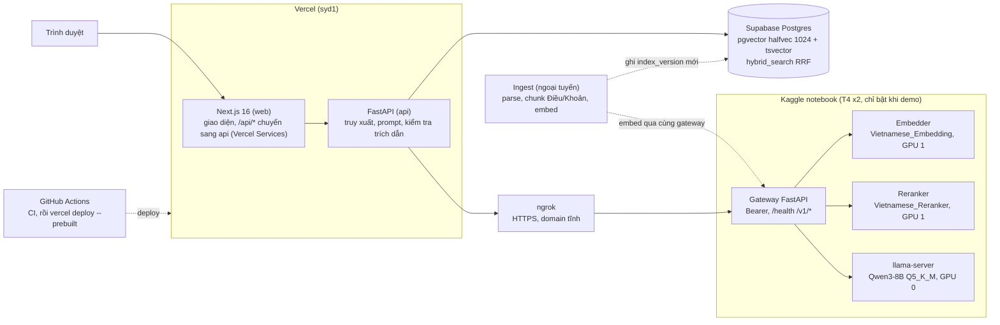
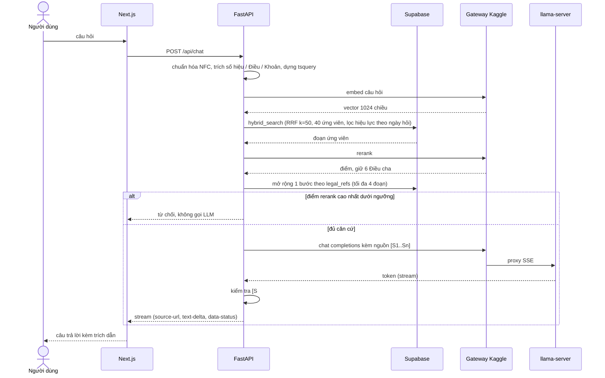

# Kiến trúc hệ thống

Nguồn Mermaid của sơ đồ trên trang Giới thiệu. Bản vẽ tay, theo giao diện sáng/tối, nằm ở `frontend/src/components/about/architecture-diagram.tsx`: sửa sơ đồ thì sửa cả hai chỗ. Thiết kế đầy đủ: `docs/superpowers/specs/2026-11-22-vietnamese-legal-rag-design.md`, cách bật Kaggle: `docs/runbook-kaggle.md`.

## Thành phần

- Mọi route của gateway trừ `/health` đòi `Authorization: Bearer`. `LLM_BASE_URL` phải khớp mẫu ngrok, sai mẫu thì coi như ngoại tuyến.
- Kết nối DB từ Vercel qua pooler transaction mode (cổng 6543). Gọi gateway có timeout connect 3 s, read 60 s.
- Re-ingest ghi vào `index_version` mới, chuyển bằng `app_config.active_index_version`.

## Một câu hỏi, chế độ trực tuyến

Chế độ ngoại tuyến bỏ các bước gọi gateway: chỉ FTS cộng tra cứu ID bằng regex, trả danh sách Điều để đọc, hoặc câu trả lời đã lưu nếu khớp câu mẫu.
