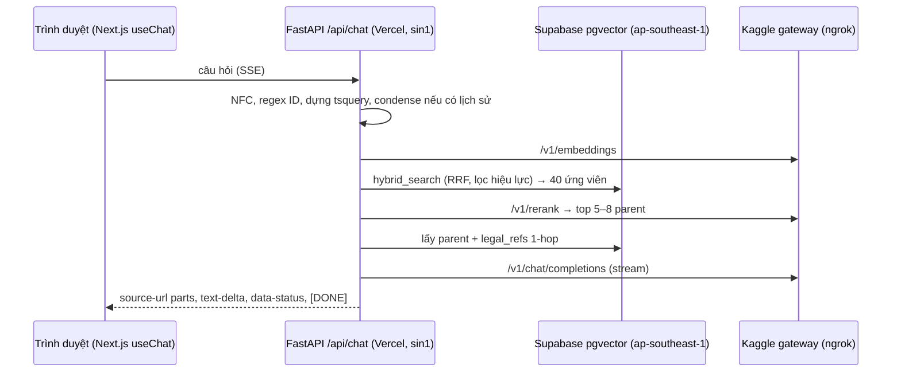

# Dựng RAG pháp luật tiếng Việt trên hạ tầng 0 đồng

*Trạng thái nghiên cứu: 22/11/2026.*

Kiến trúc nên chọn cho dự án này là **"nhẹ ở Vercel, nặng ở Kaggle"**. FastAPI trên Vercel chỉ làm ba việc: nhận HTTP, chạy regex và gọi SQL. Supabase pgvector giữ cả vector `halfvec(1024)` lẫn full-text cấu hình `simple`, rồi trộn hai nhánh bằng RRF trong một hàm SQL. Mọi mô hình chạy trên **Kaggle T4 x2** sau một gateway FastAPI có bearer token, mở ra ngoài qua **domain tĩnh miễn phí của ngrok**: embedding `AITeamVN/Vietnamese_Embedding`, reranker `AITeamVN/Vietnamese_Reranker` và LLM `Qwen3-8B` GGUF Q5_K_M chạy trên `llama-server`. Knowledge base nên gồm **8 văn bản lao động, BHXH và BHTN tải tự động từ congbao.chinhphu.vn**. robots.txt của trang cho phép crawl, và file docx đã tải thử thành công. Văn bản được chunk theo cấu trúc Điều/Khoản kèm breadcrumb. Tham chiếu chéo được trích bằng regex vào một bảng Postgres, không cần GraphRAG. Thứ người phỏng vấn nhớ là bằng chứng chứ không phải danh sách framework: một golden set khoảng 100–120 câu, một bảng ablation, một eval gate chạy trên mọi PR mà không cần GPU, và một demo không chết khi Kaggle tắt. Rủi ro lớn nhất không nằm ở kỹ thuật. Điều khoản của Kaggle giới hạn việc dùng ở mức "personal, non-commercial" và gọi tên hành vi "server farming", và đã có một báo cáo chưa kiểm chứng về việc bị khóa tài khoản vì chạy LLM server qua tunnel. Vì vậy hệ thống phải coi LLM là thành phần có thể vắng mặt bất cứ lúc nào. Ngoài ra, một dự luật sửa Bộ luật Lao động đang nằm ở Quốc hội (đề xuất hiệu lực 01/03/2027), nên schema phải cho thêm văn bản sửa đổi mà không phải dựng lại.

## Tám văn bản lao động – BHXH – BHTN trên Công báo là corpus tốt nhất

**congbao.chinhphu.vn là nguồn duy nhất vừa tải được bằng script, vừa có file Word gốc, vừa cho phép crawl.** robots.txt của trang là `User-agent: * / Allow: /` ([robots.txt Công báo](https://congbao.chinhphu.vn/robots.txt)). Mỗi văn bản có một trang HTML tĩnh dạng `/van-ban/<slug>-<id>.htm`. Trang này link tới PDF có lớp text trên `congbaocdn.chinhphu.vn` và tới `.doc`/`.docx` qua `g7.cdnchinhphu.vn/api/download/stream?Url=<token>&file_name=...`. Ngày 22/11/2026, nhóm nghiên cứu đã tải thử: file docx của NĐ 238/2026 trả HTTP 200 và là OOXML hợp lệ, còn PDF Luật BHXH 41/2024 dài 88 trang với **253.988 ký tự trích được** ([NĐ 238/2026](https://congbao.chinhphu.vn/van-ban/nghi-dinh-so-238-2026-nd-cp-469913/66580.htm); [Luật 41/2024](https://congbao.chinhphu.vn/van-ban/luat-so-41-2024-qh15-42576.htm)). Các nguồn khác đều kém hơn. Nhiều PDF trên `datafiles.chinhphu.vn` là ảnh scan: bản NĐ 158/2025 dài 52 trang chỉ cho khoảng 200 ký tự, tức chữ ký số ([datafiles 238/2026](https://datafiles.chinhphu.vn/cpp/files/vbpq/2026/7/238-ndcp.signed.pdf)). vbpl.vn được viết lại thành app Next.js năm 2026, link đính kèm cũ trả 404 và robots chặn `/api/` ([vbpl robots](https://vbpl.vn/robots.txt)). thuvienphapluat trả 403 chống bot ([thuvienphapluat](https://thuvienphapluat.vn/robots.txt)).

**Bộ A (lao động + BHXH + BHTN) thắng bộ B (giao thông) và bộ đất đai.** Bộ A gồm VBHN 18/VBHN-VPQH (Bộ luật Lao động hợp nhất), NĐ 145/2020, NĐ 293/2025, NĐ 399/2026, Luật BHXH 41/2024, NĐ 158/2025, Luật Việc làm 74/2025 và NĐ 374/2025. Cả 8 văn bản đều có trên Công báo hoặc datafiles. Chúng dẫn chiếu nhau dày đặc: ví dụ NĐ 374/2025 dẫn đồng thời Luật BHXH, "khoản 5 Điều 35 Luật Bảo hiểm y tế" và "Điều 47 Luật Việc làm" ([NĐ 374/2025](https://congbao.chinhphu.vn/van-ban/nghi-dinh-so-374-2025-nd-cp-468724.htm)). Bộ này còn có sẵn một bài kiểm tra suy luận theo thời gian. NĐ 293/2025 quy định lương tối thiểu năm 2026, với vùng I là 5.310.000 đồng ([EY](https://www.ey.com/vi_vn/technical/tax/tax-and-law-updates/nghi-dinh-293-2025nd-cp-quy-dinh-muc-luong-toi-thieu-doi-voi-nguoi-lao-dong-lam-viec-theo-hop-dong-lao-dong)). NĐ 399/2026 nâng vùng I lên **5.700.000 đồng từ 01/01/2027** ([datafiles NĐ 399/2026](https://datafiles.chinhphu.vn/cpp/files/vbpq/2026/11/399_2026_nd-cp_02112026_6-signed.signed.pdf)). Một câu như "trả 5,5 triệu ở vùng I năm 2026 có vi phạm không, còn năm 2027 thì sao" chỉ trả lời đúng được khi hệ thống biết hiệu lực của từng văn bản, và đó là câu chuyện phỏng vấn tốt hơn mọi demo "chat with PDF". Bộ B cũng hấp dẫn nhờ cặp văn bản gốc và văn bản sửa đổi NĐ 168/2024 → NĐ 238/2026. Nhược điểm của nó là bảng mức phạt dài và lặp, khó chunk, và chưa có VBHN hợp nhất hai nghị định này ([Công báo NĐ 168/2024](https://congbao.chinhphu.vn/van-ban/nghi-dinh-so-168-2024-nd-cp-43733/54010.htm)). Nên giữ B làm corpus thứ hai. Bộ đất đai bị loại vì Luật Đất đai (sửa đổi) đang được thông qua ở kỳ họp tháng 10–12/2026 ([VOV](https://vov.vn/chinh-tri/trinh-quoc-hoi-du-an-luat-dat-dai-tai-ky-hop-cuoi-nam-2026-post1312168.vov)).

**Về pháp lý, có thể commit file gốc vào repo public.** Điều 15 Luật Sở hữu trí tuệ loại "văn bản quy phạm pháp luật, văn bản hành chính…" khỏi đối tượng bảo hộ quyền tác giả ([Luật Minh Khuê](https://luatminhkhue.vn/van-ban-phap-luat-co-duoc-bao-ho-quyen-so-huu-tri-tue-khong.aspx)). Phần chú giải và hỏi đáp của các trang thương mại không thuộc diện ngoại lệ này. Bản Điều 15 sau lần sửa năm 2025 chưa được đọc từ nguồn gốc, nên README chỉ cần trích điều luật và ghi link trang nguồn của từng văn bản.

Script tải nên đi theo đúng dữ liệu thật trong `corpus_manifest.json`, và có ba chi tiết dễ bị bỏ sót. Thứ nhất, văn bản 2024–2025 chỉ có `.doc` (Word 97) nên phải chạy `soffice --headless --convert-to docx`. Văn bản 2026 có sẵn `.docx`. Thứ hai, văn bản dài bị tách thành nhiều số Công báo. NĐ 145/2020 có hai phần (số 1203–1204 và 1205–1206) cần ghép lại, và phải bỏ header kiểu "CÔNG BÁO/Số … /Ngày …" ([Công báo NĐ 145/2020](https://congbao.chinhphu.vn/van-ban/nghi-dinh-so-145-2020-nd-cp-32732.htm)). Thứ ba, **metadata cào tự động sai ở vài chỗ**. Trong manifest, "hiệu lực" của Luật 41/2024 ghi 29/06/2024, nhưng đó là ngày ban hành; các quy định chính có hiệu lực từ 01/07/2025. Hai VBHN có ngày `null`, và NĐ 399/2026 không có trong manifest vì chỉ nằm trên datafiles. Vì vậy bảng `legal_docs` phải được biên tập tay (số hiệu, loại, ngày ban hành, ngày hiệu lực, tình trạng, văn bản thay thế), còn script chỉ lo tải file. Script cũng nên cào lại trang HTML mỗi lần chạy thay vì hard-code token `g7`. Token đứng yên qua hai lần tải cách nhau 30 phút, nhưng chưa ai biết nó có hết hạn hay không.

Về parse: dùng `python-docx` cho DOCX vì đọc được trực tiếp đoạn văn, bảng và cấu trúc. Dùng PyMuPDF cho PDF có lớp text. Chỉ dùng Docling + RapidOCR (`vi`) cho bản scan, sau khi tinh chỉnh ngưỡng confidence trên một mẫu. Một thử nghiệm tiếng Hàn cho thấy giảm ngưỡng của EasyOCR xuống 0,2 đã kéo CER từ 0,525 về 0,070 ([WikiDocs](https://wikidocs.net/441143); [Docling OCR](https://docling-project.github.io/docling/concepts/OCR/)). Nếu chọn đúng nguồn Công báo thì bộ A không cần OCR. Bước bắt buộc là `unicodedata.normalize('NFC', …)` ở cả lúc ingest lẫn lúc query.

## Pipeline truy xuất: cấu trúc Điều/Khoản và mô hình fine-tune tiếng Việt quan trọng hơn framework

**Hai mô hình fine-tune tiếng Việt bỏ xa mô hình đa ngữ gốc.** Trên tập Legal Zalo 2021, `AITeamVN/Vietnamese_Embedding` (fine-tune từ BGE-M3, 1024 chiều, cửa sổ 2048 token, không cần prefix) đạt **Acc@1 0,727 và MRR@10 0,818**, so với 0,568 và 0,682 của BGE-M3 gốc. `AITeamVN/Vietnamese_Reranker` đẩy hai chỉ số này lên **0,794 và 0,867** ([thẻ mô hình AITeamVN](https://huggingface.co/AITeamVN/Vietnamese_Embedding)). Ứng viên thứ hai là `mainguyen9/vietlegal-harrier-0.6b`, được huấn luyện trên khoảng 500.000 chunk luật cắt theo điều. Mô hình này đạt NDCG@10 0,781 trên ZacLegal, nhưng giới hạn 512 token và bắt buộc prefix `Instruct: …\nQuery: ` cho câu hỏi; quên prefix là một lỗi chất lượng không báo ([thẻ vietlegal-harrier](https://huggingface.co/mainguyen9/vietlegal-harrier-0.6b)). Hai thẻ dùng metric và split khác nhau nên không xếp hạng trực tiếp được. Chọn AITeamVN làm mặc định vì nó không cần prefix, vừa nguyên một Điều và cùng kiến trúc với BGE-M3. vietlegal-harrier dùng để A/B. Cần loại `darklethelong/vnlegal-lal` dù điểm 0,849 trông hấp dẫn: mô hình này được huấn luyện trên chính các câu hỏi train của Zalo ([thẻ vnlegal-lal](https://huggingface.co/darklethelong/vnlegal-lal)). Ghi chú về LLM serving gợi ý `BAAI/bge-m3` và `bge-reranker-v2-m3`. Cặp AITeamVN có cùng kích thước và kiến trúc nhưng có bằng chứng tiếng Việt tốt hơn, nên báo cáo này chọn AITeamVN và giữ `BAAI/bge-reranker-v2-m3` làm phương án dự phòng.

**Chunk theo cấu trúc pháp lý: Điều là parent, Khoản là child.** Child được tách tiếp theo Điểm khi một Khoản vượt khoảng 450 token. Trước mỗi child, thêm một breadcrumb tất định, ví dụ `[Nghị định 145/2020/NĐ-CP – …] Chương III > Điều 12. … | Khoản 2:`, cho cả nhánh embedding lẫn FTS. Đây là phiên bản miễn phí, dựa trên quy tắc, của Contextual Retrieval của Anthropic. Trong thử nghiệm gốc, thêm ngữ cảnh vào embedding hạ tỷ lệ truy xuất hỏng top-20 từ 5,7% xuống 3,7%, thêm vào BM25 xuống 2,9%, và thêm rerank xuống **1,9%** ([Anthropic](https://www.anthropic.com/news/contextual-retrieval)). Văn bản luật vốn có cấu trúc rõ, nên breadcrumb đã mang phần lớn thông tin "đoạn này thuộc luật nào, điều nào". Chỉ nên dùng LLM để sinh ngữ cảnh khi eval chỉ ra những khoản kiểu "các trường hợp quy định tại khoản 1" bị trượt. Corpus khoảng 1,2–1,5 triệu ký tự, theo ước tính vượt xa ngưỡng 200.000 token mà Anthropic cho là có thể bỏ RAG và nhét cả vào prompt, và lớn hơn rất nhiều so với context 16K của LLM chạy trên T4. Đây là câu trả lời sẵn cho câu hỏi phỏng vấn "sao không nhét hết vào prompt?".

**Lưu trữ và tìm kiếm đều nằm gọn trong Supabase free.** Lưu vector dạng `halfvec(1024)`, tốn `2*d+8` byte mỗi dòng, bằng một nửa `vector`. HNSW hỗ trợ halfvec tới 4.000 chiều ([pgvector README](https://github.com/pgvector/pgvector)), nên vài nghìn chunk chỉ chiếm vài chục MB trong hạn mức 500 MB. Nhánh lexical dùng FTS có sẵn của Postgres với cấu hình `simple`. Lý do: ParadeDB trên Supabase là một replica tách riêng chứ không phải extension trong database ([Supabase ParadeDB](https://supabase.com/partners/integrations/paradedb)), còn `pg_textsearch` cần `shared_preload_libraries` ([PostgreSQL news](https://www.postgresql.org/about/news/pg_textsearch-v10-3264)). Có một cái bẫy quan trọng: `websearch_to_tsquery` mặc định nối các từ bằng AND, nên câu hỏi tiếng Việt 15 âm tiết gần như không khớp chunk nào. FastAPI phải tự dựng tsquery theo bốn bước: chuẩn hóa NFC, bỏ stopword (`của, và, là, các…`), giữ cụm trong ngoặc kép thành `<->`, rồi OR phần còn lại. Số hiệu văn bản (`145/2020/NĐ-CP`) và "Điều N, khoản M" được trích bằng regex thành filter hoặc boost trên cột metadata, không dựa vào FTS. Hai nhánh được trộn theo mẫu `hybrid_search` RRF của Supabase (`rrf_k=50`, trọng số 1/1) ([Supabase Hybrid Search](https://supabase.com/docs/guides/ai/hybrid-search)), có ba chỉnh sửa: truyền cấu hình `simple` tường minh, bỏ giới hạn cứng 30 để 40 ứng viên đến được reranker, và mặc định lọc văn bản còn hiệu lực. Kết quả rerank giữ lại top 5–8 parent. Không cần tách từ (underthesea, pyvi) vì cả ba embedder ứng viên nhận văn bản thô. VnCoreNLP cần Java nên không chạy được trên Vercel.

**Dùng bảng tham chiếu regex thay cho GraphRAG.** Một nghiên cứu năm 2026 về KG-RAG cho luật Việt Nam đạt **85,7% độ chính xác câu trả lời**, so với 62,3% của BM25 và 71,5% khi chỉ dùng LLM ([DST journal](https://dsjournals.com/dst/DST-V5I1P101)). Như vậy cấu trúc đồ thị có giá trị. Nhưng VLegal-Bench cho thấy LLM giỏi đoán *có* quan hệ hơn là xác định *đúng* điều khoản được dẫn chiếu ([VLegal-Bench](https://arxiv.org/html/2512.14554)), trong khi dẫn chiếu trong luật Việt Nam đi theo khuôn mẫu cứng ("điểm a khoản 2 Điều 5 Nghị định số …", "quy định chi tiết", "sửa đổi, bổ sung"). Do đó regex trích vào bảng `legal_refs(src_chunk_id, dst_doc_id, dst_article, dst_clause, rel)` vừa chính xác hơn, vừa không cần thêm hạ tầng. Sau khi rerank, hệ thống mở rộng 1 hop, thêm tối đa 3–5 đoạn liên quan: đoạn mà khoản hiện tại trỏ tới, và các điều của Nghị định "quy định chi tiết" điều luật đang xét. Chi phí chỉ là một JOIN có index. LightRAG, GraphRAG và Neo4j để vào mục "future work".

**Xử lý câu hỏi theo thứ tự lợi nhiều tốn ít.** (1) Viết lại câu hỏi thành câu độc lập khi có lịch sử hội thoại; lượt đầu thì bỏ qua. (2) Trích ID pháp lý bằng regex; câu hỏi chỉ đích danh "Điều 12 NĐ 145/2020" thì lấy thẳng dòng đó. (3) Dựng tsquery như trên. (4) Tùy chọn sinh 2–3 câu diễn đạt lại để nối từ ngữ đời thường với thuật ngữ luật ("đuổi việc" → "đơn phương chấm dứt hợp đồng lao động"), nhưng chỉ giữ nếu eval chứng minh có lợi. Bỏ HyDE: một "điều luật giả" có thể mang số điều bịa vào nhánh lexical. **Trích dẫn và từ chối được kiểm tra tất định.** Mỗi đoạn đưa vào LLM có ID `[S#]` kèm số hiệu, Điều, Khoản và tình trạng hiệu lực. Backend parse `[S#]`, gắn cờ ID không được cung cấp và những "Điều N" không có trong header. Hệ thống từ chối *trước* khi gọi LLM nếu điểm rerank cao nhất thấp hơn ngưỡng τ, chọn trên tập câu hỏi không trả lời được. Một bước verifier sau khi sinh chỉ cải thiện việc giữ trích dẫn thêm 0,022–0,034 ([arXiv 2609.27376](https://arxiv.org/abs/2609.27376)), nên các kiểm tra rẻ phải đi trước.

## Kaggle T4 x2 chạy được Qwen3-8B qua llama.cpp, nhưng ToS mới là giới hạn thật

**Phần cứng dùng được duy nhất là T4 x2 (2 × 16 GB, sm_75), khoảng 30 GPU-giờ mỗi tuần và 12 giờ mỗi phiên** ([maborak, 29/10/2026](https://www.maborak.com/blog/kaggle-free-gpu-ai-server); [dev.to T4x2](https://dev.to/tahsine/free-35b-multimodal-llm-server-on-kaggle-gpu-accessible-from-any-openai-compatible-client-4m2h)). P100 không còn chạy được với PyTorch hiện tại của Kaggle ([Kaggle PR #1544](https://github.com/Kaggle/docker-python/pull/1544)), và vLLM đòi compute capability ≥ 7.5 ([vLLM docs](https://docs.vllm.ai/en/stable/getting_started/installation/gpu/)). `kaggle kernels push` không chọn được loại GPU, nên phải mở notebook trên trình duyệt, chọn T4 x2 và bấm Run All. Với các phiên demo 1–2 giờ, 30 giờ mỗi tuần đủ cho 15–25 buổi. Hạn mức không phải nút thắt. Tài khoản mới là nút thắt: Kaggle Terms (hiệu lực 22/06/2025) yêu cầu "your own internal, personal, non-commercial use", loại trừ việc dùng "for the benefit of any third party", và liệt kê "server farming" là lạm dụng ([maborak](https://www.maborak.com/blog/kaggle-free-gpu-ai-server); [Kaggle Terms](https://kaggle.com/terms)). Một người bình luận báo bị khóa tài khoản ở lần chạy thứ hai với lý do "server farm" ([dev.to](https://dev.to/tahsine/free-35b-multimodal-llm-server-on-kaggle-gpu-accessible-from-any-openai-compatible-client-4m2h)). Báo cáo này chưa được kiểm chứng, nhưng đủ để không coi nhẹ rủi ro.

**Chọn LLM bằng bằng chứng gián tiếp, vì chưa có bảng VMLU nào chấm Qwen3, Qwen3.5 hay Qwen3.6.** Thế hệ 2024 tụ quanh 50–57 điểm VMLU: Qwen2.5-7B-Instruct 57,51, Vistral-7B 50,07, SeaLLM-7B-v2.5 53,30. Trong khi đó một bản fine-tune từ Qwen3-VL-8B-Thinking đạt **74,87** ([VMLU leaderboard](https://vmlu.ai/leaderboard)). Các mô hình đứng đầu VMLU (85–90 điểm) của Viettel, MISA hay VinSmart đều là mô hình riêng, không tải được. Vì vậy chọn **Qwen3-8B GGUF Q5_K_M** làm mặc định: transformer GQA thuần, Apache-2.0, khoảng 6 GB, nằm gọn trên một T4 cùng KV cache 16K. Có ba ứng viên A/B. **Qwen3.5-9B** (Apache-2.0) mới hơn nhưng dùng kiến trúc Gated-DeltaNet lai, và công thức vLLM chính thức không liệt kê T4 ([vLLM recipe Qwen3.5-9B](https://recipes.vllm.ai/Qwen/Qwen3.5-9B)), nên chỉ thử qua llama.cpp. **`AITeamVN/Vi-Qwen2-7B-RAG`** được huấn luyện riêng cho việc từ chối khi ngữ cảnh thiếu câu trả lời và chịu được ngữ cảnh nhiễu bằng tiếng Việt, nhưng là Qwen2 với context 8K ([thẻ Vi-Qwen2-7B-RAG](https://huggingface.co/AITeamVN/Vi-Qwen2-7B-RAG)). **Qwen3.6-35B-A3B** (MoE, 3B tham số hoạt động) đã chạy được trên Kaggle T4x2 bằng llama.cpp với bản UD-Q4_K_XL khoảng 22 GB. Đây là phương án vươn xa, nhưng sẽ chật khi phải chia GPU với embedder và reranker. Cần tránh Gemma 4 trên vLLM vì head_dim 512 vượt shared memory của Turing ([vLLM forum](https://discuss.vllm.ai/t/title-outofresources-shared-memory-98304-65536-on-turing-sm75-global-attention-layers-with-head-dim-512/2990)), cùng mọi checkpoint AWQ-MoE, Marlin hay compressed-tensors, vì chúng đòi sm_80 ([vLLM #26297](https://github.com/vllm-project/vllm/issues/26297)).

**`llama-server` là engine đáng tin nhất trên T4 năm 2026.** Bản build với `-DCMAKE_CUDA_ARCHITECTURES=75` cần symlink `libcuda.so` và mất khoảng 26 phút. Vì vậy chỉ build một lần, lưu binary **cùng toàn bộ file `.so`** thành Kaggle Dataset. Với cách đó, cold start mỗi phiên chỉ còn 5–6 phút. Health check phải chờ `status == "ok"`, vì HTTP 200 có thể trả về ngay cả khi server vẫn "loading" ([dev.to](https://dev.to/tahsine/free-35b-multimodal-llm-server-on-kaggle-gpu-accessible-from-any-openai-compatible-client-4m2h)). Bố cục GPU: **GPU0** chạy `llama-server` (Qwen3-8B, `-c 16384 -np 2 --jinja`, tắt thinking). **GPU1** chạy một gateway FastAPI giữ embedder và reranker fp16 (khoảng 1,1 GB mỗi mô hình), mở `/v1/embeddings` và `/v1/rerank`, proxy SSE cho `/v1/chat/completions`, và kiểm tra `Authorization: Bearer` trên mọi route. Như vậy chỉ có một cổng, một lớp auth, và GPU1 còn dư hơn 10 GB để nạp thêm một LLM A/B. Tốc độ ước tính theo băng thông 320 GB/s là **25–40 token/giây** cho một luồng 8B Q4/Q5, nên câu trả lời 500 token mất 15–20 giây và streaming là bắt buộc ([NVIDIA T4](https://www.nvidia.com/en-us/data-center/tesla-t4/)). Con số này chưa được đo; phải chạy `llama-bench` ở phiên đầu tiên.

**ngrok dev domain giải được bài toán URL.** Gói free của ngrok cấp một hostname `*.ngrok-free.app` cố định, "doesn't change when you restart the agent", không có timeout, kèm hạn mức 1 GB egress và 20.000 request mỗi tháng. Trang cảnh báo của ngrok chỉ hiện với trình duyệt và "does not affect API clients" ([ngrok free plan](https://ngrok.com/docs/pricing-limits/free-plan-limits)). Cloudflare Quick Tunnel bị loại vì **không hỗ trợ SSE** và đổi hostname mỗi lần tạo ([Cloudflare docs](https://developers.cloudflare.com/cloudflare-one/networks/connectors/cloudflare-tunnel/do-more-with-tunnels/trycloudflare/)). Named tunnel của Cloudflare thì cần tự sở hữu domain ([Cloudflare remote tunnel](https://developers.cloudflare.com/cloudflare-one/networks/connectors/cloudflare-tunnel/get-started/create-remote-tunnel/)). Ghi chú về Vercel đề xuất lưu URL vào bảng `app_config` vì giả định URL đổi mỗi phiên. Khi đã có domain tĩnh, việc này thành thừa: `LLM_BASE_URL` chỉ cần là một env var. Bảng `app_config` để làm phương án dự phòng nếu buộc phải chuyển sang tunnel có URL thay đổi. Cũng phải kiểm tra rằng URL khớp mẫu `^https://[a-z0-9-]+\.ngrok-free\.(app|dev)$` để chặn SSRF. Mỗi câu hỏi tốn 3 request qua tunnel (embed, rerank, chat), nên hạn mức 20.000 request tương đương khoảng 6.600 câu hỏi mỗi tháng. Có một mâu thuẫn chưa giải quyết: tác giả bài dev.to nói ngrok free "cuts streaming responses", trái với tài liệu của ngrok. Phiên Kaggle đầu tiên phải có một bài test stream dài 2 phút.

**Giảm rủi ro ToS bằng thiết kế, không bằng hy vọng.** Chỉ bật notebook ngay trước buổi phỏng vấn và tắt ngay sau đó. Dùng đúng một tài khoản, không công khai URL tunnel, và để token trong Kaggle Secrets. Quan trọng nhất, ứng dụng phải chạy được khi LLM vắng mặt. Cần chú ý một ràng buộc ẩn: embedding câu hỏi cũng nằm trên Kaggle, nên khi Kaggle tắt thì nhánh dense chết theo. Chế độ offline vì vậy phải dựa vào **FTS `simple` cộng tra cứu ID bằng regex**, trả về các điều luật liên quan kèm thông báo "Mô hình đang ngoại tuyến". Thêm vào đó là câu trả lời dựng sẵn cho các câu hỏi nổi bật, lưu trong Supabase, và một video demo 60–90 giây ở đầu README.

## Một repo, một domain: Vercel Services ghép Next.js với FastAPI, còn CI không phụ thuộc GPU

**Vercel Services (beta, có trên mọi gói kể cả Hobby) là cách chính thức năm 2026 để chạy Next.js và FastAPI trong một project.** Một file `vercel.json` khai báo hai service, rewrite `/api/*` sang FastAPI và phần còn lại sang Next.js, trên cùng một domain nên không cần CORS ([Vercel Services](https://vercel.com/docs/services)). Python trên Vercel đã GA, mặc định Python 3.12, cài dependency từ `pyproject.toml`/`uv.lock`, giới hạn bundle 500 MB và hỗ trợ streaming. Trên Hobby, mỗi function cố định 2 GB / 1 vCPU, chạy ở một region, và tối đa 300 giây kể cả thời gian stream ([Vercel Python runtime](https://vercel.com/docs/functions/runtimes/python); [Vercel limits](https://vercel.com/docs/functions/limitations)). Ngân sách thật sự giới hạn chat streaming là **360 GB-giờ bộ nhớ mỗi tháng**, không phải 4 giờ Active CPU, vì thời gian chờ I/O không tính vào CPU ([fair use](https://vercel.com/docs/limits/fair-use-guidelines)). Theo ước tính, mức này đủ cho khoảng 21.000 câu trả lời 30 giây. Nên đặt `maxDuration` khoảng 60–120 giây và timeout cho httpx để một tunnel treo không đốt hết 300 giây. Backend tuyệt đối không cài torch: chỉ fastapi, httpx, `psycopg[binary]` và pydantic. Mọi thứ nặng thuộc về thư mục `pipelines/`, nơi không được deploy.

Layout repo đề xuất:

```
repo/
├─ vercel.json            # services: web (frontend/), api (backend/, app.main:app) + rewrites
├─ frontend/              # Next.js 16, pnpm, AI SDK v7 useChat, shadcn/ui + AI Elements (bản shadcn)
├─ backend/               # FastAPI: chỉ runtime deps, chứa luôn code retrieval dùng chung
├─ pipelines/             # KHÔNG deploy: download, parse, chunk, refs, embed, eval
├─ kaggle/                # notebook + gateway.py (embed/rerank/proxy chat, bearer auth)
├─ supabase/migrations/   # pgvector, bảng, hàm hybrid_search
├─ eval/                  # golden set, qrels, cache embedding, baselines, results
├─ docs/adr/  docs/architecture.md (Mermaid)
└─ .github/workflows/     # ci.yml, eval-retrieval.yml, eval-full.yml, db-deploy.yml, deploy.yml
```

Luồng một request:



**Phía UI dùng AI SDK v7 `useChat`, còn FastAPI tự phát UI Message Stream protocol.** Protocol này là SSE chở các part JSON, đi kèm header `x-vercel-ai-ui-message-stream: v1` và kết thúc bằng `data: [DONE]`. Các part `source-url` dùng cho trích dẫn, còn part tự đặt tên `data-status` báo LLM online hay offline ([AI SDK stream protocol](https://ai-sdk.dev/docs/ai-sdk-ui/stream-protocol); [AI SDK 7](https://vercel.com/blog/ai-sdk-7)). Emitter viết tay khoảng 25 dòng, không thêm dependency và dễ unit test. Lựa chọn này tốt hơn AI SDK for Python (đang beta, mặc định đi qua AI Gateway) và tốt hơn adapter của Pydantic AI (mới tài liệu hóa cho v5/v6) ([Vercel KB Python AI SDK](https://vercel.com/kb/guide/python-and-ai-sdk); [Pydantic AI](https://pydantic.dev/docs/ai/integrations/ui/vercel-ai/)). Về component, `elements.ai-sdk.dev` sẽ **bị deprecate vào cuối tháng 11/2026** và chuyển vào shadcn/ui dưới dạng component copy vào project ([AI Elements](https://elements.ai-sdk.dev/); [shadcn AI Elements](https://ui.shadcn.com/docs/ai-elements)). Vì vậy dùng bản trên shadcn ngay từ đầu. Font dùng `next/font/google` với subset `vietnamese` và đặt `<html lang="vi">`. Route `GET /api/health` ping `/health` của gateway với timeout 2–3 giây, để UI hiển thị badge online/offline.

**Supabase kết nối qua pooler ở chế độ transaction, cổng 6543.** Pooler dùng IPv4 trên mọi gói. Cấu hình pool size 1 và tắt prepared statement. Kết nối trực tiếp chỉ có IPv6 nếu không mua add-on ([Supabase connecting](https://supabase.com/docs/guides/database/connecting-to-postgres)). Gói free cho 2 project, 500 MB và **tự pause sau một tuần ít hoạt động** ([Supabase pricing](https://supabase.com/pricing)). Vì vậy cần một cron hằng ngày của Vercel gọi `/api/cron/keepalive` có kiểm tra `CRON_SECRET`; Hobby chỉ cho cron chạy mỗi ngày một lần ([Vercel cron](https://vercel.com/docs/cron-jobs/usage-and-pricing)). Đặt Supabase ở `ap-southeast-1` và function Vercel ở `sin1`. Chống lạm dụng có ba lớp. Lớp một là một rule WAF rate limit cho `/api/chat`; Hobby được 1 rule ([Vercel WAF](https://vercel.com/docs/vercel-firewall/vercel-waf/rate-limiting)). Lớp hai là bộ đếm theo IP cộng trần toàn cục mỗi ngày trên Upstash Redis free, gọi qua REST với httpx (500.000 lệnh mỗi tháng) ([Upstash](https://upstash.com/pricing/redis)). Lớp ba là giới hạn độ dài input bằng Pydantic. Observability dùng **Langfuse Hobby**: 50.000 unit mỗi tháng, giữ dữ liệu 30 ngày, SDK Python v5 dựa trên OpenTelemetry, và nhớ gọi `flush()` trong `finally` của generator SSE ([Langfuse pricing](https://langfuse.com/pricing); [Langfuse SDK](https://langfuse.com/docs/observability/sdk/python/overview)). Runtime log của Vercel Hobby chỉ giữ **1 giờ** ([Vercel limits](https://vercel.com/docs/limits)), nên không thể dùng nó để debug sau buổi demo. Với 7–8 unit mỗi request, Langfuse là hạn mức chật nhất của cả hệ thống (khoảng 6.000 request mỗi tháng), nhưng vẫn dư cho mục đích portfolio.

**Toàn bộ CI/CD nằm trong GitHub Actions, đúng như yêu cầu.** Bước deploy dùng `vercel pull` → `vercel build` → `vercel deploy --prebuilt`, với `"git": {"deploymentEnabled": false}` để Vercel không deploy hai lần, và job deploy `needs: ci-ok` ([Vercel + GitHub Actions](https://vercel.com/kb/guide/how-can-i-use-github-actions-with-vercel)). Lý do chọn cách này: production chỉ nhận code đã xanh CI, và README kể được câu chuyện "CD gated by eval". Cách này cũng là đường bắt buộc nếu repo thuộc GitHub organization, vì Hobby không kết nối Git với repo của org ([Vercel limits](https://vercel.com/docs/limits)). **Chưa ai xác nhận `--prebuilt` chạy được với project dùng Services.** Nếu spike ở giai đoạn 0 thất bại, quay về Vercel Git integration cộng branch protection bắt buộc `ci-ok`. `ci.yml` dùng path filter tách các job web (pnpm lint/typecheck/vitest/build), api (`uv lock --check`, `uv sync --locked`, ruff, pyright, pytest với LLM được mock bằng respx), db (`supabase db start` cộng smoke test pgvector) và eval-retrieval. Một job tổng `ci-ok` là check bắt buộc duy nhất ([uv GitHub Actions](https://docs.astral.sh/uv/guides/integration/github/)). Migration chạy bằng `supabase link` + `supabase db push` trên `main`, trong GitHub Environment `production`. Chỉ dùng migration kiểu cộng thêm (additive), vì preview và production dùng chung một database ([Supabase environments](https://supabase.com/docs/guides/deployment/managing-environments)). Bổ sung Dependabot cho npm, uv và github-actions, kèm `uv lock --check` để chặn lockfile lệch ([uv Dependabot](https://docs.astral.sh/uv/guides/integration/dependabot/)), cùng một bước gitleaks.

## Bảng ablation và eval gate là thứ nhà tuyển dụng nhớ

**Tiêu chí tuyển dụng nhất quán ở một điểm: bằng chứng hơn lắp ghép.** Louis-François Bouchard viết rằng "Writing LangChain or Pinecone on a resume does not show whether you can build a reliable product". Theo ông, "one polished project with evaluation, deployment, monitoring, and an honest README" thắng nhiều demo chung chung, và "a demo that worked on one cherry-picked example tells an interviewer almost nothing" ([Bouchard](https://www.louisbouchard.ai/what-i-look-for-when-hiring-ai-engineers/)). Hamel Husain và Jason Liu chỉ ra cùng một thứ tự làm việc: đo truy xuất bằng metric IR trước, sau đó dùng LLM judge đã được kiểm chứng, rồi mới phân tích lỗi ([Hamel](https://hamel.dev/blog/posts/evals-faq/how-should-i-approach-evaluating-my-rag-system.html); [Jason Liu](https://jxnl.co/writing/2025/05/19/there-are-only-6-rag-evals/)). Điều này dẫn tới quyết định về framework: **viết Python thuần ở đường phục vụ, không dùng LangChain hay LlamaIndex.** Pipeline chỉ có một luồng, parser phải hiểu Phần/Chương/Điều/Khoản, và mọi quyết định phải nhìn thấy được trong code ([bswen](https://docs.bswen.com/blog/2026-10-16-do-you-need-langchain-for-rag)). RAGAS hoặc DeepEval chỉ nằm trong `eval/`, với version được pin.

**Golden set được LLM sinh trước rồi người sửa, có hạn mức theo loại câu hỏi và nhãn ở cấp Điều.** Viết tay 30 câu trước để hiểu corpus, sau đó cho LLM soạn thêm khoảng 100 câu từ từng Điều/Khoản và sửa tay toàn bộ. Tỷ lệ gợi ý: khoảng 35% câu một bước, 15% câu số liệu hoặc ngày, 20% câu đa bước qua nhiều văn bản (Luật ↔ Nghị định ↔ VBHN), 10% câu so sánh, 10% câu không trả lời được, và 5–10% câu ngoài phạm vi hoặc prompt injection. Nhãn gold là ID ở cấp điều (`LuatBHXH2024:D33:K1`), nên vẫn dùng được sau mỗi lần đổi cách chunk. Một nghiên cứu năm 2026 về QA luật lao động chỉ dùng 231 cặp câu hỏi ([arXiv 2609.27376](https://arxiv.org/pdf/2609.27376)), cho thấy quy mô 100–250 câu là đáng tin. Soạn câu hỏi không phải là sinh câu trả lời, nên dùng một LLM free tier khác họ mô hình (ví dụ Gemini) để soạn không vi phạm ràng buộc dự án. Corpus là luật công khai, nhưng điều khoản unpaid của Gemini cho phép người duyệt đọc dữ liệu và cấm gửi dữ liệu nhạy cảm ([Gemini API terms](https://aistudio.google.com/docs/terms)). Vì vậy tuyệt đối không gửi truy vấn thật của người dùng lên đó. Dùng Zalo Legal 2021 (`GreenNode/zalo-ai-legal-text-retrieval-vn`, 818 câu test) để chọn embedder và reranker, không dùng nó để đo chất lượng end-to-end ([HF dataset](https://huggingface.co/datasets/GreenNode/zalo-ai-legal-text-retrieval-vn)).

**Eval gate trên PR phải tất định và không cần Kaggle.** Embedding câu hỏi golden được cache, khóa theo model ID, và commit vào repo. Index đóng băng được nạp vào Postgres + pgvector chạy ngay trên runner. Các metric Hit@1, Recall@5/10/20, MRR@10 và nDCG@10 được tính bằng `ranx`. Thư viện này đã được đối chiếu với TREC Eval và có kiểm định ý nghĩa thống kê ([ranx](https://github.com/AmenRa/ranx)). Gate so sánh với `baselines/main.json` và ghi kết quả vào một sticky comment trên PR. Với n≈100, mỗi câu hỏi tương đương khoảng 1 điểm Hit@k, nên phải ghi rõ "không có ý nghĩa thống kê" khi đúng là như vậy. Người phỏng vấn hiểu IR sẽ để ý điều này. Eval đầy đủ (`workflow_dispatch` lúc Kaggle bật) chạy sinh câu trả lời end-to-end, cùng các kiểm tra tất định: trích dẫn hợp lệ, precision/recall của trích dẫn so với điều gold, khớp số và ngày, từ chối đúng. Ngoài ra có judge chạy cục bộ và một judge free khác họ mô hình chạy trên một tập con. Judge phải được kiểm chứng trên khoảng 40 câu do người gán nhãn, vì nghiên cứu cho thấy LLM-as-judge đa ngữ kém nhất quán ở ngôn ngữ ít tài nguyên ([arXiv 2505.12201](https://arxiv.org/abs/2505.12201)). Câu "judge đồng thuận với nhãn của tôi trên 40 câu, κ = …" hiếm thấy trong portfolio và trả lời thẳng vào điểm yếu này.

**Câu chuyện CV được viết từ chính các con số.** Hình mẫu là bảng ablation theo phong cách Anthropic Contextual Retrieval: FTS → dense → hybrid RRF → + rerank → + breadcrumb → + mở rộng tham chiếu, kèm p50/p95 latency lấy từ Langfuse. Thêm vào đó là bảng phân tích theo loại câu hỏi, ma trận nhầm lẫn của việc từ chối, và một PR cho thấy gate đã chặn được một lần regression. Bộ ADR (pgvector thay vì vector DB riêng, self-host LLM, không dùng LangChain, regex thay GraphRAG, judge free chỉ dùng cho eval) cho thấy năng lực ra quyết định, thứ mà Bouchard nói là "matter more" so với output.

### Thứ tự xây dựng gợi ý cho kế hoạch nhiều giai đoạn

| Giai đoạn | Nội dung | Tiêu chí xong |
|---|---|---|
| P0 – Spike rủi ro | Build llama.cpp sm_75 và lưu Dataset; gateway + ngrok, test stream 2 phút; hello-world Vercel Services + `vercel deploy --prebuilt` từ Actions; kiểm tra `extversion` của pgvector trên Supabase | Cả 4 spike chạy được hoặc đã chọn phương án dự phòng |
| P1 – Corpus & schema | Script tải Công báo, chuyển `.doc`, ghép nhiều phần, parse Điều/Khoản, `legal_docs` biên tập tay, `legal_refs` bằng regex, migration | 8 văn bản đã vào bảng; có thống kê số Điều/Khoản và token |
| P2 – Truy xuất & eval nền | 30 câu golden viết tay; embed trên Kaggle; `hybrid_search`; harness ranx; cache embedding câu hỏi | Bảng FTS / dense / hybrid đầu tiên |
| P3 – Sinh câu trả lời | Rerank, mở rộng parent + 1-hop, prompt `[S#]`, kiểm tra hậu kỳ, ngưỡng từ chối τ | Câu trả lời có trích dẫn, qua kiểm tra tất định |
| P4 – UI & offline | Next.js useChat, emitter SSE, Sources/Inline Citation, health badge, chế độ FTS-only, câu trả lời dựng sẵn | Demo chạy được cả khi Kaggle tắt |
| P5 – CI/CD & eval đầy đủ | `ci-ok`, gate retrieval, `eval-full`, golden set ~120 câu, kiểm chứng judge, migration và deploy gated | Có PR chứng minh gate chặn regression |
| P6 – Hoàn thiện portfolio | Langfuse + feedback, WAF + Upstash, guardrail, ADR, sơ đồ, dataset card, video demo | README có số liệu; hướng dẫn chạy lại được kiểm thử từ một clone mới |

## Quyết định đề xuất

| Thành phần | Quyết định | Phương án dự phòng / A/B | Ghi chú |
|---|---|---|---|
| Lĩnh vực corpus | Bộ A: lao động + BHXH + BHTN (8 văn bản A1–A8) | Bộ B giao thông (9 văn bản) làm corpus thứ 2 | Đất đai bị loại (luật mới sắp có) |
| Nguồn tải | congbao.chinhphu.vn, cào lại trang HTML, ưu tiên `.docx` > `.doc` > PDF congbaocdn | datafiles.chinhphu.vn chỉ cho NĐ 399/2026 | Delay 1–2 s, User-Agent mô tả rõ; không dùng vbpl API hay thuvienphapluat |
| Lưu file gốc | Commit vào repo kèm manifest sha256 | GitHub Release asset | Điều 15 Luật SHTT; README ghi nguồn |
| Metadata văn bản | Bảng `legal_docs` biên tập tay (ngày hiệu lực, tình trạng, thay thế) | — | Manifest tự động có ngày sai hoặc null |
| Parse | `python-docx`; `.doc` → `soffice --headless --convert-to docx`; PyMuPDF cho PDF có text | Docling + RapidOCR `vi` cho scan | NFC ở ingest và query; bỏ header Công báo |
| Chunking | Điều = parent, Khoản = child (≤400–512 token), tách theo Điểm khi >450; breadcrumb tất định | Contextual Retrieval bằng LLM nếu eval cho thấy cần | Lưu `content` và `embed_text` riêng |
| Embedding | `AITeamVN/Vietnamese_Embedding` (1024 chiều, fp16) | `mainguyen9/vietlegal-harrier-0.6b` (+ prefix query) | Embed corpus một lần qua gateway |
| Vector store | Supabase pgvector `halfvec(1024)`, HNSW `halfvec_ip_ops`, `ef_search` 100 | — | Đo bằng `pg_relation_size` sau lần nạp đầu |
| Lexical | Postgres FTS `simple` + tsquery OR tự dựng + stopword; ID qua regex → cột metadata | `unaccent` tsvector phụ cho câu hỏi không dấu | Không tách từ |
| Fusion | Hàm SQL `hybrid_search` RRF `rrf_k=50`, 40 ứng viên, lọc theo hiệu lực | Tăng `full_text_weight` lên 1,5 khi có ID | `ranx` để tối ưu offline |
| Reranker | `AITeamVN/Vietnamese_Reranker`, top 40 → 5–8 parent, max_length 512 | `BAAI/bge-reranker-v2-m3`, `Qwen/Qwen3-Reranker-0.6B` | Điểm rerank cũng dùng làm ngưỡng từ chối |
| Tham chiếu chéo | Bảng `legal_refs` trích bằng regex, mở rộng 1-hop ≤3–5 đoạn | GraphRAG/LightRAG ghi là "future work" | Quan hệ cấp văn bản lấy từ phần "Căn cứ…" |
| Xử lý query | Condense (từ lượt 2) → regex ID → dựng tsquery | Multi-query 2–3 câu nếu eval có lợi | Không HyDE, không LLM router |
| Trích dẫn & từ chối | `[S#]` + kiểm tra hậu kỳ trong FastAPI + ngưỡng τ trước khi gọi LLM | Verifier pass (lợi ích nhỏ) | Hiển thị tình trạng hiệu lực và ngày |
| LLM | `Qwen3-8B` GGUF Q5_K_M (Q4_K_M nếu thiếu VRAM), tắt thinking, temperature thấp | A/B: Qwen3.5-9B Q4_K_M, Vi-Qwen2-7B-RAG; stretch: Qwen3.6-35B-A3B UD-Q4_K_XL | Kiểm tra repo GGUF trên HF |
| Serving engine | llama.cpp `llama-server` build sm_75, binary + `.so` lưu thành Kaggle Dataset | vLLM `--dtype half --enforce-eager` chỉ cho Qwen3-8B dense | Tránh Gemma 4, AWQ-MoE, Marlin trên T4 |
| Bố cục GPU | GPU0: LLM; GPU1: gateway embed + rerank | GPU1 nạp thêm LLM A/B | Weights đặt sẵn trong `/kaggle/input` |
| Gateway | FastAPI trong notebook: `/v1/embeddings`, `/v1/rerank`, proxy `/v1/chat/completions` (SSE), `/health`, bearer token | `llama-server --api-key` nếu bỏ gateway | So sánh hằng thời gian |
| Tunnel | ngrok free dev domain tĩnh | Cloudflare named tunnel (cần domain); `app_config` cho URL thay đổi | Không dùng Cloudflare Quick Tunnel (không có SSE) |
| Cấu hình URL LLM | Env var `LLM_BASE_URL` + `LLM_API_KEY` (Sensitive) | Bảng Supabase `app_config` + cache TTL | Allowlist regex chống SSRF |
| Chế độ offline | FTS-only + tra cứu ID + câu trả lời dựng sẵn + badge health + video demo | — | Bắt buộc vì rủi ro ToS |
| Frontend | Next.js 16 + `@ai-sdk/react` v7 `useChat` + shadcn/ui AI Elements (bản shadcn) | assistant-ui | Font subset `vietnamese`, `lang="vi"` |
| Streaming protocol | UI Message Stream v1, emitter Python tự viết, `source-url` + `data-status` | Text Stream protocol | Kiểm tra lại tên field ở v7 |
| Backend | FastAPI, Python 3.12, uv, không torch, `maxDuration` 60–120 s | — | Route có tiền tố `/api` |
| Framework RAG | Python thuần (không LangChain/LlamaIndex) | DSPy làm stretch | RAGAS/DeepEval chỉ nằm trong `eval/` |
| DB driver | `psycopg[binary]` 3 qua pooler 6543, tắt prepare, pool 1 | `asyncpg` với `statement_cache_size=0` | — |
| Region | Supabase `ap-southeast-1`, Vercel `sin1` | `iad1` mặc định | `sin1` trên Hobby chưa xác minh |
| Deploy topology | Một project Vercel Services (`web` + `api`), rewrite `/api/*` công khai | Hai project + rewrite (timeout proxy 120 s) | Services đang beta |
| Repo | Repo cá nhân (không thuộc org), monorepo theo layout trên | — | Hobby không kết nối Git với repo của org |
| CI | `ci.yml` với path filter, web/api/db/eval jobs, `ci-ok` là check bắt buộc duy nhất | — | `uv lock --check`, gitleaks |
| CD | Actions: `vercel pull/build/deploy --prebuilt`, `needs: ci-ok`, `git.deploymentEnabled=false` | Vercel Git integration + branch protection | Spike ở P0 |
| Migration | `supabase db push` trên `main`, Environment `production`, chỉ additive | — | CI dùng `supabase db start` cục bộ |
| E2E | Playwright với URL preview, chấp nhận `llm: offline` | — | Kiểm tra có sources trả về |
| Golden set | ~100–120 câu, LLM soạn + người sửa 100%, nhãn cấp Điều, dataset card | Zalo 2021 cho chọn mô hình | 30 câu viết tay trước |
| Eval truy xuất | `eval-retrieval.yml` trên PR: cache embedding + index đóng băng + ranx + baseline + sticky comment | — | Ngưỡng đặt sau baseline đầu tiên |
| Eval sinh câu trả lời | `eval-full.yml` (dispatch khi Kaggle bật): kiểm tra tất định + judge cục bộ + judge free trên tập con | — | Judge kiểm chứng trên ~40 nhãn người |
| Observability | Langfuse Cloud Hobby, `flush()` trong `finally`, feedback 👍/👎 làm score | Bảng `feedback` trong Supabase | Prompt version theo git |
| Chống lạm dụng | WAF 1 rule `/api/chat` + Upstash theo IP và trần toàn cục + giới hạn input | BotID nếu bị lạm dụng | Không lộ key ra trình duyệt |
| Keep-alive | Vercel cron hằng ngày `/api/cron/keepalive` | GitHub schedule 3 ngày/lần | Free pause sau 1 tuần |
| Tài liệu | README có ablation, ADR, sơ đồ Mermaid, dataset card, phần giới hạn, video demo | — | "Không phải tư vấn pháp lý" |

## Rủi ro & câu hỏi mở

| Rủi ro / câu hỏi | Mức | Hiện trạng | Giảm thiểu / việc cần làm |
|---|---|---|---|
| Kaggle ToS: endpoint công khai bị coi là "server farming"; có 1 báo cáo khóa tài khoản (chưa kiểm chứng); một thread phản hồi nói Kaggle lọc request tới local network ([Kaggle discussion](https://www.kaggle.com/discussions/product-feedback/743895)) | Cao | Chỉ Kaggle mới phân xử được; câu chữ trong điều khoản nghiêng về phía cấm | Phiên ngắn, một tài khoản, bearer token, không công khai URL, chế độ offline, video demo; phương án dự phòng là HF Inference Endpoints hoặc ZeroGPU (ngoài phạm vi, chỉ giữ làm contingency) |
| Hạn mức Kaggle "trôi", có thể phải xếp hàng giờ cao điểm; idle timeout mâu thuẫn (20 hay 60 phút) | Trung bình | Chỉ có nguồn thứ cấp | Bật notebook sớm 15 phút trước phỏng vấn; giữ một cell chạy liên tục |
| Kaggle có còn bắt xác minh số điện thoại để bật Internet không | Thấp | Chưa xác minh | Kiểm tra ở P0 |
| Dự luật sửa Bộ luật Lao động trình ngày 21/10/2026, đề xuất hiệu lực 01/03/2027 ([Đại biểu Nhân dân](https://daibieunhandan.vn/bao-dam-quyen-loi-ich-cua-nguoi-lao-dong-10435012.html)) | Trung bình | Chưa có kết quả biểu quyết | Schema có `status`/`replaced_by`; khi luật được thông qua, thêm làm demo "amended-by" |
| Bộ Nội vụ đang soạn sửa Luật BHXH 2024 và NĐ 158/159/2025 ([dự thảo](https://gatewayduthaoonline.quochoi.vn/uploadFiles/host/local/2026/6/22/16/389d219178f54d5085b4bfae2092dd78.pdf)) | Thấp–TB | Mới ở giai đoạn dự thảo | Theo dõi; câu trả lời ghi "theo văn bản hiện hành tại ngày…" |
| NĐ 399/2026 chỉ có hiệu lực từ 01/01/2027 | Thấp (là tính năng) | Đã biết | Lọc hiệu lực phải phân biệt "đã ban hành, chưa hiệu lực"; câu hỏi golden về thời gian |
| NĐ 145/2020 có bị sửa trong 2025–2026 không (chính quyền 2 cấp) | Trung bình | Chưa kiểm tra | Tra tình trạng trên vbpl.vn bằng tay trước P1 |
| Token `g7` của Công báo có hết hạn không; ToS của congbao/vanban chưa đọc | Thấp | Mới kiểm robots.txt | Cào lại trang mỗi lần chạy; commit file gốc |
| Vercel Services (beta): key cấu hình theo service (`functions`, `maxDuration`, region), FastAPI có thấy tiền tố `/api` hay không | Trung bình | Chưa đọc config reference | Spike P0; route khai báo kèm `/api` |
| `vercel build --prebuilt` với project Services; Protection Bypass for Automation trên Hobby | Trung bình | Chưa xác minh | Spike P0; dự phòng bằng Git integration |
| Region `sin1` có chọn được trên Hobby không | Thấp | Chưa xác minh | Dự phòng `iad1` (latency tăng) |
| Phiên bản pgvector trên Supabase (iterative scan cần ≥0.8.0); giới hạn bộ nhớ khi build HNSW trên gói free | Thấp | Chưa xác minh | `select extversion …` ở P0 |
| ngrok free có cắt stream dài không (mâu thuẫn nguồn); thay đổi gói free tháng 2/2026 | Trung bình | Tài liệu nói không có timeout | Test stream 2 phút ở P0 |
| Cờ của `llama-server` (`-fa on`, `--chat-template-kwargs`, `--reasoning-budget`) | Thấp | Từ kiến thức sẵn có | Kiểm tra bằng `--help` khi build |
| Chất lượng tiếng Việt của Qwen3-8B / Qwen3.5-9B / Vi-Qwen2-7B-RAG chưa được chấm trên VMLU hay RAG | Trung bình | Chỉ có bằng chứng gián tiếp | A/B trên golden set (faithfulness, tỷ lệ từ chối) |
| Mọi số tốc độ (25–40 tok/s, TTFT 1–3 s, cold start) chưa được đo trên Kaggle | Trung bình | Ước tính theo băng thông | `llama-bench` + latency từ Langfuse |
| Embedding câu hỏi phụ thuộc Kaggle nên nhánh dense chết khi offline | Trung bình | Đã thiết kế quanh | FTS-only offline; embedder ONNX trên Vercel chưa kiểm chứng (cold start, chất lượng) |
| Tên field của `source-url`/`data-*` ở AI SDK v7, giá trị header có còn `v1` | Thấp | Chưa mở trang v7 | Kiểm tra trước P4; có unit test protocol |
| Độ tin cậy của LLM judge trên tiếng Việt; RAGAS/DeepEval chưa được đánh giá với tiếng Việt | Trung bình | Nghiên cứu cho thấy kém ở ngôn ngữ ít tài nguyên | Kiểm chứng trên ~40 nhãn, 2 judge khác họ, ưu tiên kiểm tra tất định |
| Hạn mức free tier của judge (Groq, Gemini, OpenRouter) dễ thay đổi | Thấp | Chỉ xác minh một phần | Kiểm tra lại trên console khi triển khai; pin model ID |
| GitHub tắt workflow định kỳ trên repo public sau 60 ngày không hoạt động; ngưỡng pause của Supabase không công bố | Thấp | Hành vi lâu năm, chưa kiểm lại | Keep-alive chính là cron của Vercel |
| Câu hỏi mở cho người dùng | — | — | (1) Chốt bộ A hay cả A + B? (2) Repo cá nhân hay org? (3) Có mua domain để dùng Cloudflare named tunnel không? (4) Chấp nhận rủi ro Kaggle hay chuẩn bị sẵn phương án host trả phí tối thiểu? |

## Kết luận

Nghiên cứu cho thấy giới hạn đặt hình dạng cho kiến trúc. GPU miễn phí nhưng không đáng tin, Vercel không chạy được mô hình, Supabase chỉ có 500 MB. Từ đó sinh ra một hệ thống trong đó **mọi thứ không phải mô hình đều tất định và kiểm thử được mà không cần GPU**: regex, SQL, RRF, kiểm tra trích dẫn, eval truy xuất. Đây chính là phần người phỏng vấn muốn đào sâu. LLM chỉ là lớp cuối cùng, và có thể vắng mặt. Hệ quả thực tế là kế hoạch triển khai nên dồn công sức vào corpus có hiệu lực theo thời gian, bảng tham chiếu chéo và eval gate, thay vì đuổi theo mô hình lớn hơn. Với corpus nhỏ và có cấu trúc chặt như luật Việt Nam, chuyển từ BGE-M3 gốc sang một bản fine-tune tiếng Việt đã cho thêm khoảng 16 điểm Acc@1 mà không tốn thêm hạ tầng nào.

Điểm khác biệt khó sao chép nhất của dự án nằm ở miền dữ liệu chứ không ở stack: trả lời đúng theo ngày hiệu lực (NĐ 293/2025 so với NĐ 399/2026), lần theo chuỗi "Luật → Nghị định quy định chi tiết", và từ chối khi không có căn cứ. Đúng lúc hệ thống đang được xây thì Quốc hội đang sửa Bộ luật Lao động. Nếu schema được thiết kế để thêm văn bản sửa đổi mà không phải dựng lại, chính sự thay đổi pháp luật đó sẽ trở thành bản demo "amended-by" thuyết phục nhất trong buổi phỏng vấn.
